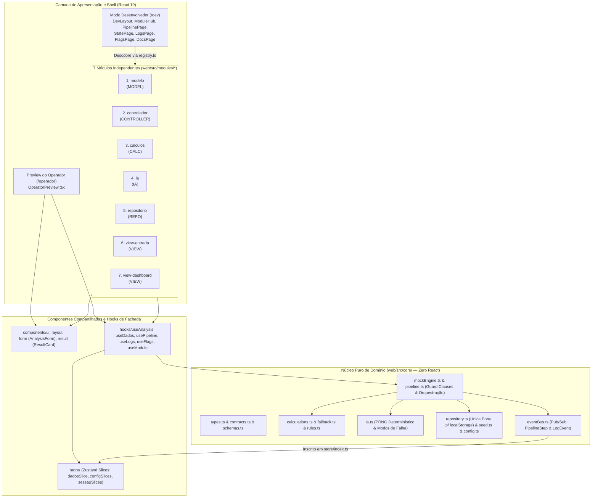
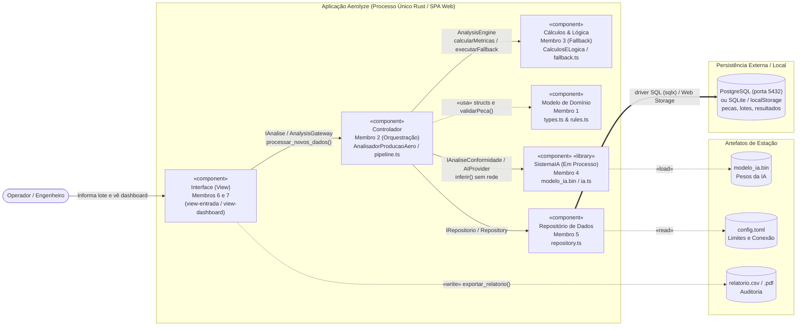
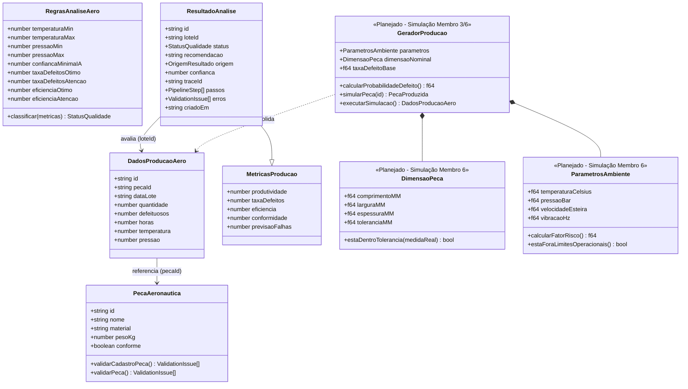
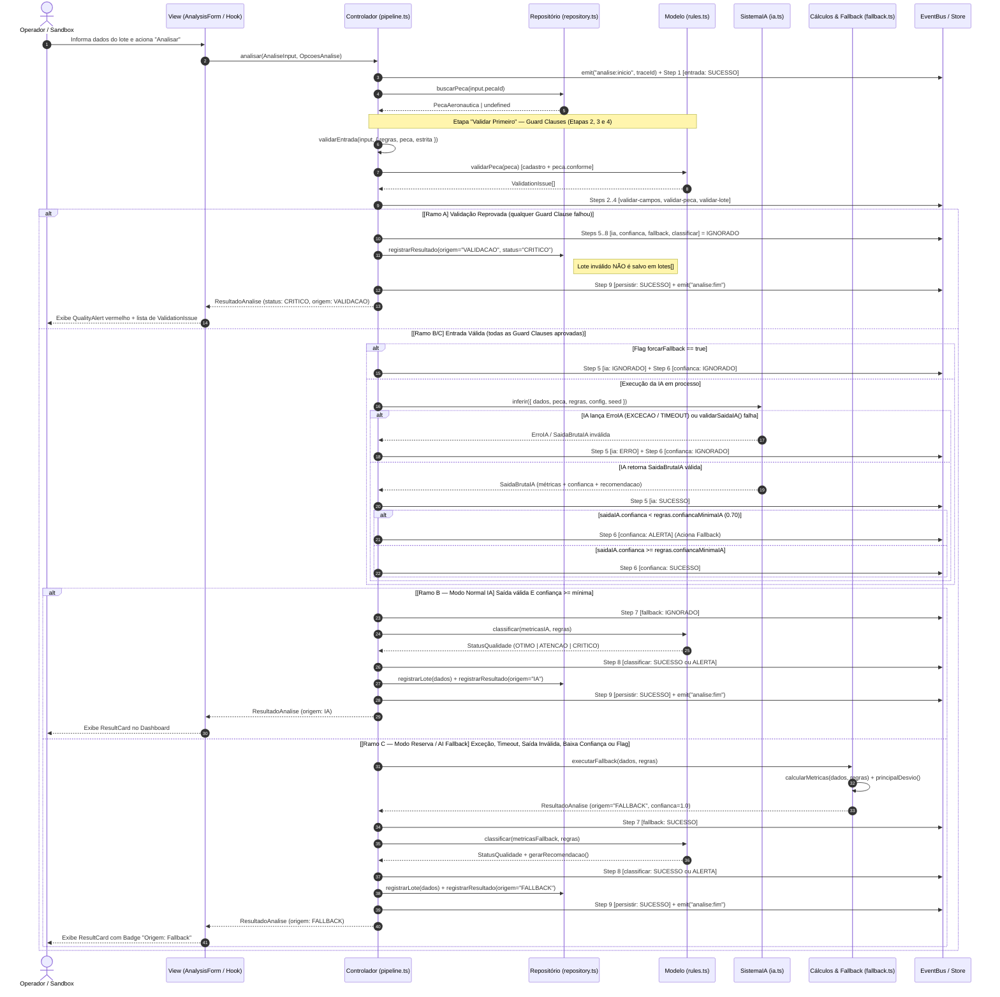
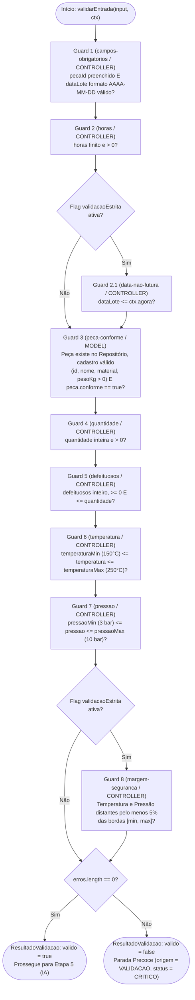
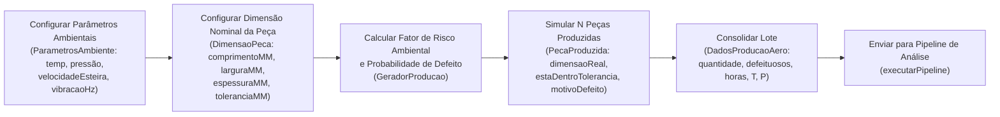

# Planejamento e Especificação Acadêmica de Engenharia de Software — Plataforma Aerolyze & Aerolyze Lab

> **Instituição:** Universidade Federal de Alagoas (UFAL) — Instituto de Computação (IC)
> **Disciplina:** Conceitos de Linguagem de Programação (CLP)
> **Equipe Sigma (Grupo 4):** Camila Maria Farias Silva, Luana Marina Santos Ferro, Matheus Lopes dos Santos, Mauricio Mateus dos Santos, Pedro Henrique Balbino Rocha, Rian Antonio da Silva Gaião, Tainara Gomes de Oliveira
> **Escopo do Documento:** Consolidação arquitetural, análise reversa do front-end mockado (`web/`), mapeamento de fluxos (implementados e futuros), especificação de Requisitos (RF/RNF), catálogo de Histórias de Usuário (HUs) em padrão acadêmico (BDD) e plano de evolução guiado pelos agentes e skills da equipe (`agents-sigma/`).

---

## Sumário

1. [Introdução, Contexto Industrial e Justificativa Acadêmica](#1-introdução-contexto-industrial-e-justificativa-acadêmica)
2. [Evolução Conceitual e Arquitetural nos Materiais de Apoio](#2-evolução-conceitual-e-arquitetural-nos-materiais-de-apoio)
3. [Arquitetura do Sistema e Modelagem Estrutural (UML / Mermaid)](#3-arquitetura-do-sistema-e-modelagem-estrutural-uml--mermaid)
4. [Análise Técnica do Front-End Mockado (`web/`) e Auditoria via `agents-sigma`](#4-análise-técnica-do-front-end-mockado-web-e-auditoria-via-agents-sigma)
5. [Fluxos de Execução Planejados, Implementados e Futuros](#5-fluxos-de-execução-planejados-implementados-e-futuros)
6. [Especificação de Requisitos (Funcionais e Não Funcionais)](#6-especificação-de-requisitos-funcionais-e-não-funcionais)
7. [Catálogo Acadêmico de Histórias de Usuário (HUs) e Critérios BDD](#7-catálogo-acadêmico-de-histórias-de-usuário-hus-e-critérios-bdd)
8. [Matriz de Rastreabilidade e Planejamento de Evolução (Roadmap)](#8-matriz-de-rastreabilidade-e-planejamento-de-evolução-roadmap)

---

## 1. Introdução, Contexto Industrial e Justificativa Acadêmica

### 1.1. O Problema da Conformidade Aeroespacial
Na indústria aeroespacial (Indústria 4.0), falhas de conformidade em peças estruturais ou de propulsão — ou a detecção tardia de desvios térmicos, barométricos e dimensionais no processo produtivo — acarretam riscos catastróficos à segurança de voo e custos exponenciais de correção. Conforme fundamentado no *Pitch da Equipe Sigma* (`Pitch - CLP Grupo 4.pdf`), o estudo clássico do **NASA Johnson Space Center (INCOSE, 2004)** demonstra a escalada do custo relativo de correção de defeitos ao longo do ciclo de vida:

| Fase de Detecção | Custo Relativo de Correção | Impacto Operacional |
|---|---|---|
| **Requisitos** | `1x` (Referência) | Ajuste documental e de especificação |
| **Projeto (Design)** | `3x – 8x` | Retrabalho de engenharia e parâmetros |
| **Produção (Manufatura)** | `7x – 16x` | Segregação de lote, recalibração de ferramental |
| **Teste / Integração** | `21x – 78x` | Desmontagem de subconjuntos e reteste |
| **Operação (Em Voo)** | `29x – 1.615x` | Recall global, AOG (*Aircraft on Ground*), incidentes graves |

Dois casos reais recentes fundamentam a necessidade de **conformidade verificada por software, e não presumida**:
1. **Fraude da AOG Technics (2019–2023):** comercialização de mais de 60 mil peças de motor (majoritariamente para turbinas CFM56) com certificados de aeronavegabilidade falsificados, gerando prejuízos de £ 39,3 milhões e alertas emergenciais da CAA, FAA e EASA.
2. **Incidente do Voo Alaska Airlines 1282 (jan/2024 — Relatório Final NTSB jul/2025):** ejeção de tampão de porta (*door plug*) em voo devido à reinstalação sem parafusos de retenção, evidenciando lacunas de controle, rastreabilidade e validação na linha de produção.

### 1.2. Princípio Central da Solução: *"Validar Primeiro, Analisar Depois"*
Para responder a esse cenário, a **Plataforma Aerolyze** estabelece uma arquitetura determinística e resiliente guiada por quatro pilares de engenharia:
1. **Parada Precoce (*Guard Clauses* locais):** Nenhuma análise preditiva é executada sobre dados corrompidos, peças não conformes ou lotes com parâmetros físicos fora da faixa operacional. O Controlador barra a requisição antes de acionar a IA.
2. **IA Embarcada em Processo (`SistemaIA` / `modelo_ia.bin`):** A inferência de taxa de defeitos, previsão de falhas e recomendação ocorre em memória (sem dependência de rede/HTTP externa entre Controlador e IA).
3. **Modo Reserva Determinístico (*Fallback*):** Se a IA lançar exceção, sofrer *timeout*, retornar schema inválido ou apresentar grau de confiança inferior ao limiar configurado (`confiancaMinimaIA`, padrão `0.70`), o módulo de **Cálculos & Lógica** assume instantaneamente com fórmulas matemáticas determinísticas.
4. **Segurança de Memória e Tipagem Estrita (Rust + TypeScript):** A concepção nativa em **Rust** (sem coletor de lixo, com *borrow checker* prevenindo ~70% das classes de CVEs de memória reportadas por Microsoft MSRC e Chromium) é espelhada no ambiente web **Aerolyze Lab** (`web/`) em **TypeScript estrito** (zero `any`, schemas Zod e núcleo funcional puro em `web/src/core/`).

---

## 2. Evolução Conceitual e Arquitetural nos Materiais de Apoio

A análise cruzada de todos os artefatos da pasta `material de apoio/` revela três estágios evolutivos complementares do projeto, sintetizados na tabela a seguir:

| Dimensão | Geração 1: Analisador & Simulador Industrial (`clp- apresentação 2 (1).pdf`, `Diagrama de Pacotes CLP.pdf`) | Geração 2: Arquitetura Nativa Aerolyze em Rust (`Pitch - CLP Grupo 4.pdf`, `Diagrama de Componentes.pdf`, `Diagrama de Sequência Aerolyze.pdf`, `divisao-tarefas-aerolyze.pdf`) | Geração 3: Aerolyze Lab MVP & Modo Desenvolvedor (`PROMPT-Aerolyze-Lab-MVP.md`, `DIVISAO-TAREFAS-Aerolyze-MVP.md`, `web/`) |
|---|---|---|---|
| **Foco Principal** | Cálculo de indicadores de turno e simulação estocástica de peças dimensionais em linha de produção. | Plataforma aeroespacial em executável único Rust (`cargo build --release`), IA embarcada e SGBD relacional externo. | Ambiente web modular em React 19 + TS para trabalho paralelo dos 7 membros, com sandboxes isolados, telemetria e Preview do Operador. |
| **Entidades de Domínio** | `DadosProducao`, `RegrasAnalise`, `ResultadoAnalise`, `DimensaoPeca`, `ParametrosAmbiente`, `PecaProduzida`, `GeradorProducao`. | `PecaAeronautica`, `DadosProducaoAero`, `RegrasAnaliseAero`, `ResultadoAnalise`, `AnalisadorProducaoAero`, `CalculosELogica`, `SistemaIA`. | `PecaAeronautica`, `DadosProducaoAero`, `RegrasAnaliseAero`, `MetricasProducao`, `ResultadoAnalise`, `PipelineStep`, `ValidationIssue`, `LogEvent`, `FlagsDev`. |
| **Camada de Controle** | `AnalisadorProducao` (calcula produtividade, defeitos, eficiência e classifica em Boa/Atenção/Ruim). | `Controlador` separado em Orquestração/Guard Clauses (Membro 2) e Lógica/Fallback `otimizar_parametros()` (Membro 3). | `pipeline.ts` + `mockEngine.ts` (Membro 2) desacoplados de `calculations.ts` + `fallback.ts` (Membro 3) via contrato `AnalysisEngine`. |
| **Inteligência Artificial** | Ausente na v1 inicial (apenas regras determinísticas e gerador estocástico). | Biblioteca `SistemaIA` vinculada ao binário carregando `modelo_ia.bin` via interface `IAnaliseConformidade`. | `mockAIProvider` (`ia.ts`) determinístico por PRNG (`seedEfetiva`), simulando `NENHUM`, `EXCECAO`, `TIMEOUT`, `BAIXA_CONFIANCA` e `SAIDA_INVALIDA`. |
| **Persistência e Config** | Em memória durante a execução. | `IRepositorio` + driver SQL (`sqlx` → PostgreSQL na porta 5432 ou SQLite `.db`) + leitura de `config.toml` e escrita de `relatorio.csv`/`.pdf`. | Contrato `Repository` implementado em `repository.ts` sobre `localStorage` (`aerolyze-lab:v1`) com validação Zod, auto-recuperação de JSON corrompido e gerador `paraToml()` (`config.ts`). |
| **Interface (View)** | Telas claras ("Calculador de Eficiência") com cards de recomendação triplos e modal "Configurar Limites". | Dividida entre Membro 6 (`DadosDeProducao` + simulação dimensional) e Membro 7 (`ResultadosDaAnalise` + alertas + CSV/PDF). | Tema escuro aeronáutico (`navy-900`/`grafite-800`), Modo Desenvolvedor (`/dev` com Hub, 7 Sandboxes, Pipeline, Estado, Logs, Flags, Docs) e Preview do Operador (`/operador`). |

---

## 3. Arquitetura do Sistema e Modelagem Estrutural (UML / Mermaid)

### 3.1. Arquitetura em Camadas e Isolamento de Módulos
O projeto adota o padrão **MVC Estendido com Contratos Explícitos**, dividindo a responsabilidade entre os **7 membros da Equipe Sigma**. No protótipo funcional (`web/`), a arquitetura impõe fronteiras verificadas estaticamente pelo script `check-architecture.sh`:

### 3.2. Diagrama de Componentes (Arquitetura Alvo Rust ↔ Mapeamento Web)
O diagrama abaixo consolida o `Diagrama de Componentes.pdf` e o `Diagrama de Implementação` (`Pitch - CLP Grupo 4.pdf`, Anexo B) com os contratos equivalentes em `web/src/core/contracts.ts`:

### 3.3. Diagrama de Classes do Domínio (Implementado + Extensões Planejadas)
O diagrama de classes a seguir unifica as estruturas **já implementadas** em `web/src/core/types.ts` com as classes de **simulação dimensional e ambiental** documentadas em `clp- apresentação 2 (1).pdf` (páginas 4, 6, 7 e 9) e `clp- apresentação 3.pdf` (página 3), permitindo visualizar o domínio completo:

### 3.4. Dicionário de Equivalência de Símbolos UML (Rust Original ↔ TypeScript `web/`)
Para garantir rastreabilidade total entre os diagramas UML em Rust (`Diagrama de Componentes.pdf`, `clp- apresentação 2 (1).pdf` e `clp- apresentação 3.pdf`) e o código em `web/src/`, a tabela abaixo relaciona cada struct, atributo e método:

| Camada | Símbolo / Método no UML Rust (`material de apoio/`) | Equivalente em TypeScript (`web/src/`) | Status |
|---|---|---|---|
| **Modelo** | `PecaAeronautica { id: u64, nome: String, peso_kg: f64, material: String, esta_conformado: bool }` | `interface PecaAeronautica { id: string; nome: string; material: string; pesoKg: number; conforme: boolean }` (`core/types.ts`) | **Implementado** |
| **Modelo** | `PecaAeronautica::validar_conformidade(&self) -> bool` | `validarPeca(peca)` e `validarCadastroPeca(peca)` (`core/rules.ts`) | **Implementado** |
| **Modelo** | `DadosProducaoAero { data_lote, quantidade_lote, temperatura_processo, pressao_processo }` + `DadosProducao { quantidadeProduzida, quantidadeDefeituosa, horasTrabalhadas }` | `interface DadosProducaoAero { id, pecaId, dataLote, quantidade, defeituosos, horas, temperatura, pressao }` (`core/types.ts`) | **Implementado (Unificado)** |
| **Modelo** | `RegrasAnaliseAero { limite_conformidade_otimo }` + `RegrasAnalise { limiteTaxaDefeitosBoa/Atencao, limiteEficienciaBoa/Atencao }` | `interface RegrasAnaliseAero` (9 campos em `core/types.ts`) + `classificar()` (`core/rules.ts`) | **Implementado (Unificado)** |
| **Modelo** | `DimensaoPeca`, `ParametrosAmbiente`, `PecaProduzida` | A criar em `core/types.ts` (Onda 2 — HU-04 / HU-21) | **Planejado** |
| **Controlador** | `AnalisadorProducaoAero` / `IAnalise::processar_novos_dados()` | `AnalysisGateway.analisar()` (`core/contracts.ts`) + `executarPipeline()` (`core/pipeline.ts`) | **Implementado** |
| **Controlador** | `validar_conformidade()` / `validar_lote()` (guard clauses) | `validarEntrada(input, ctx)` com 6 guards padrão + 2 guards estritas (`core/pipeline.ts`) | **Implementado** |
| **Cálculos** | `CalculosELogica`: `calcularProdutividade`, `calcularTaxaDefeitos`, `calcularEficiencia` | `calcularProdutividade`, `calcularTaxaDefeitos`, `calcularEficiencia`, `calcularPrevisaoFalhas`, `calcularMetricas` (`core/calculations.ts`) | **Implementado** |
| **Cálculos** | `CalculosELogica::otimizar_parametros()` (fallback + sugestão de ajuste) | `executarFallback()`, `principalDesvio()`, `gerarRecomendacao()` (`core/fallback.ts`); cálculo de setpoint ótimo planejado (HU-27) | **Implementado (Fallback) / Planejado (Setpoint)** |
| **Cálculos** | `CalculosELogica { media_peso: f64, desvio_padrao: f64, analise_historica: String }` | Agregação estatística multi-lote (Onda 2 — HU-11) | **Planejado** |
| **IA** | `SistemaIA` / `IAnaliseConformidade`: `analisar_conformidade(peca)` e `gerar_recomendacao(dados)` | `AIProvider.inferir(requisicao)` + `simularIA()` + `MODELO_IA_META` (`core/ia.ts`) | **Implementado (Mock)** |
| **Repositório** | `IRepositorio`: `buscar_peca()`, `buscar_lote()`, `registrar_resultado()`, `config.toml` | `Repository` (`core/repository.ts`) + `montarConfig()` / `paraToml()` (`core/config.ts`) | **Implementado (Local) / Planejado (SQL)** |
| **View (M6)** | `DadosDeProducao`: `capturar_dados()`, `input_temperatura`, `input_pressao`, `input_quantidade`, modal `Configurar Limites` | `AnalysisForm` + `LimitsModal` (`components/form/AnalysisForm.tsx`) + `validarFormulario()` (`core/schemas.ts`) | **Implementado** |
| **View (M6)** | `DadosDeProducao::simular_falha_manual(peca)` e `InterfaceSimulador` (`GeradorProducao`) | Botão `"Preset inválido"` no Controlador + `"Enviar direto ao Controlador"` na View; simulador dimensional completo planejado (HU-21 / HU-29) | **Parcial / Planejado** |
| **View (M7)** | `ResultadosDaAnalise`: `mostrar_dashboard(resultado)`, `exibir_alerta_qualidade(msg)` | `ResultCard`, `StatusBadge`, `QualityAlert`, `AnalysisHistoryList` (`components/result/ResultCard.tsx`) | **Implementado** |
| **View (M7)** | `ResultadosDaAnalise`: `exportar_relatorio(formato)` (`.csv` / `.pdf`) e flags `exibir_tabela`, `grafico_visivel`, `notificacao_alerta` | Exportação `.csv`/`.pdf`, gráficos de série histórica e toggles visuais planejados (Onda 2 — HU-24, HU-25, HU-30) | **Planejado** |

---

## 4. Análise Técnica do Front-End Mockado (`web/`) e Auditoria via `agents-sigma`

### 4.1. O que já está construído e operacional em `web/`
A inspeção completa do código-fonte em `web/src/` comprova que o scaffold do **Aerolyze Lab (MVP)** está **100% funcional, tipado e aderente às regras da Equipe Sigma**:

1. **Núcleo Puro (`web/src/core/`):**
   - [`types.ts`](file:///p:/IC/CLP-Sigma-Aeronautics-Parts-Analysis/web/src/core/types.ts): Define todas as entidades, enums (`StatusQualidade`, `ModuloSistema`, `StatusPasso`, `OrigemResultado`, `NivelLog`, `ModoFalhaIA`) e o envelope `DadosPersistidos` (`versao: 1`).
   - [`contracts.ts`](file:///p:/IC/CLP-Sigma-Aeronautics-Parts-Analysis/web/src/core/contracts.ts): Formaliza os contratos `GuardResult`, `ResultadoValidacao`, `AIProvider`, `AnalysisEngine`, `Repository`, `EventBus`, `AnalysisGateway` e `ModuleManifest`.
   - [`rules.ts`](file:///p:/IC/CLP-Sigma-Aeronautics-Parts-Analysis/web/src/core/rules.ts): Contém `REGRAS_PADRAO` (Temp: `150–250 °C`, Pressão: `3–10 bar`, Confiança mín. IA: `0.70`, Defeitos: `≤ 2%` Ótimo / `≤ 5%` Atenção, Eficiência: `≥ 85%` Ótimo / `≥ 70%` Atenção), `classificar()` (retorna o pior status entre defeitos e eficiência via `piorStatus`), `validarCadastroPeca()` e `validarPeca()`.
   - [`calculations.ts`](file:///p:/IC/CLP-Sigma-Aeronautics-Parts-Analysis/web/src/core/calculations.ts) e [`fallback.ts`](file:///p:/IC/CLP-Sigma-Aeronautics-Parts-Analysis/web/src/core/fallback.ts): Implementam as fórmulas determinísticas, o cálculo de `principalDesvio` (`DEFEITOS`, `EFICIENCIA`, `TEMPERATURA`, `PRESSAO`, `NENHUM`) e a geração automática de recomendações contextuais com `CONFIANCA_FALLBACK = 1`.
   - [`ia.ts`](file:///p:/IC/CLP-Sigma-Aeronautics-Parts-Analysis/web/src/core/ia.ts): Implementa PRNG determinístico (`mulberry32` + `hashTexto` FNV-1a em `utils.ts`) sobre `seedEfetiva`, metadados `modelo_ia.bin@0.1.0-mock` (precisão `0.92`), validação de saída via Zod (`saidaIASchema`) e 5 modos (`NENHUM`, `EXCECAO`, `TIMEOUT`, `BAIXA_CONFIANCA`, `SAIDA_INVALIDA`).
   - [`pipeline.ts`](file:///p:/IC/CLP-Sigma-Aeronautics-Parts-Analysis/web/src/core/pipeline.ts) e [`mockEngine.ts`](file:///p:/IC/CLP-Sigma-Aeronautics-Parts-Analysis/web/src/core/mockEngine.ts): Implementam `validarEntrada` (6 guard clauses padrão + 2 guard clauses em modo `validacaoEstrita`) e `executarPipeline` (8 etapas rastreadas por `traceId` com emissão em tempo real no `eventBus`).
   - [`repository.ts`](file:///p:/IC/CLP-Sigma-Aeronautics-Parts-Analysis/web/src/core/repository.ts), [`seed.ts`](file:///p:/IC/CLP-Sigma-Aeronautics-Parts-Analysis/web/src/core/seed.ts) e [`schemas.ts`](file:///p:/IC/CLP-Sigma-Aeronautics-Parts-Analysis/web/src/core/schemas.ts): Persistência em `localStorage` sob a chave `aerolyze-lab:v1`, com 5 peças iniciais (`P-001` a `P-005`, sendo `P-005` não conforme) e 6 lotes (`L-001` a `L-006`), recuperação automática contra JSON corrompido e schema Zod dinâmico (`criarSchemaEntrada(regras)`).
   - [`scenarios.ts`](file:///p:/IC/CLP-Sigma-Aeronautics-Parts-Analysis/web/src/core/scenarios.ts) e [`config.ts`](file:///p:/IC/CLP-Sigma-Aeronautics-Parts-Analysis/web/src/core/config.ts): 4 cenários oficiais (`CEN-A` a `CEN-D`) com verificador `compararCenario` e serializador `paraToml` para prévia do `config.toml`.

2. **Estado Global (`web/src/store/`) e Hooks (`web/src/hooks/`):**
   - Store Zustand dividida em 3 slices ([`dadosSlice.ts`](file:///p:/IC/CLP-Sigma-Aeronautics-Parts-Analysis/web/src/store/slices/dadosSlice.ts), [`configSlices.ts`](file:///p:/IC/CLP-Sigma-Aeronautics-Parts-Analysis/web/src/store/slices/configSlices.ts), [`sessaoSlices.ts`](file:///p:/IC/CLP-Sigma-Aeronautics-Parts-Analysis/web/src/store/slices/sessaoSlices.ts)) inscrita automaticamente no `eventBus` (limite de 300 logs em memória e fila de até 4 Toasts).

3. **Os 7 Módulos e Sandboxes (`web/src/modules/`):**
   - Todos os 7 módulos (`modelo`, `controlador`, `calculos`, `ia`, `repositorio`, `view-entrada`, `view-dashboard`) possuem `manifest.ts`, `sandbox.tsx` carregado via `React.lazy` e `README.md`, todos com status `"pronto"`.

### 4.2. Relatório de Auditoria do Subagente `architecture-guardian`
Aplicando os 5 critérios de inspeção definidos em [`architecture-guardian.md`](file:///p:/IC/CLP-Sigma-Aeronautics-Parts-Analysis/agents-sigma/plugins/aerolyze-sigma/agents/architecture-guardian.md) e [`check-architecture.sh`](file:///p:/IC/CLP-Sigma-Aeronautics-Parts-Analysis/agents-sigma/plugins/aerolyze-sigma/skills/aerolyze-quality-gate/scripts/check-architecture.sh):

| # | Regra Arquitetural (`AGENTS.md`) | Resultado | Evidência Técnica |
|---|---|---|---|
| 1 | **Pureza do Core (`web/src/core/`)** | **APROVADO** | Zero imports de `react`, `react-dom` ou `react-router` em todos os 16 arquivos de `src/core/`. |
| 2 | **Isolamento dos 7 Módulos (`web/src/modules/<id>/`)** | **APROVADO** | Nenhum módulo importa arquivos de outro módulo; `features/dev/` consome exclusivamente `src/modules/registry.ts`. |
| 3 | **Porta Única de Persistência (`localStorage`)** | **APROVADO** | Apenas `src/core/repository.ts` (linha 39) acessa `globalThis.localStorage`. |
| 4 | **Qualidade de UI, Acessibilidade e Tipagem** | **APROVADO** | Zero ocorrências de `: any` ou `<any>`; `StatusBadge` e `ResultCard` exibem sempre ícone (`CheckCircle2`, `AlertTriangle`, `AlertOctagon`) + texto além da cor. |
| 5 | **Invariante *"Validar primeiro, analisar depois"*** | **APROVADO** | Em `pipeline.ts` (linhas 298–323), se `!validacao.valido`, os passos `ia`, `confianca`, `fallback` e `classificar` são marcados como `IGNORADO` e a função retorna antes do bloco da IA. |

### 4.3. Lacunas Identificadas (*Gap Analysis*: Mock Atual vs. Visão Completa dos Materiais)
A comparação exaustiva entre o que já está implementado em `web/` e todos os artefatos de `material de apoio/` evidencia os 10 pontos exatos de evolução até o produto final:

| # | Funcionalidade / Artefato | Origem no Material de Apoio | Estado Atual em `web/` | Ação Planejada (Backlog de Evolução) |
|---|---|---|---|---|
| 1 | **Configuração de Limiares de Classificação no Modal** | `clp- apresentação 2 (1).pdf` (pág. 14 — "Configurar Limites": Eficiência mínima e Defeitos máximos) | `RegrasAnaliseAero` já possui `taxaDefeitosOtimo`, `taxaDefeitosAtencao`, `eficienciaOtimo`, `eficienciaAtencao`, mas o `LimitsModal` (`AnalysisForm.tsx`) só exibe inputs para Temperatura, Pressão e Confiança da IA. | Expandir `LimitsModal` (Membro 6 — HU-20) para editar também os 4 limiares percentuais de classificação. |
| 2 | **Botão `"Preencher Exemplo"` e Injeção Manual de Falha (`simular_falha_manual`)** | `clp- apresentação 2 (1).pdf` (pág. 10) e `clp- apresentação 3.pdf` (pág. 3 — `DadosDeProducao`) | `ControladorSandbox` tem `"Preset válido/inválido"`, mas `AnalysisForm` não tem seletor de presets de turno nem botão de injeção de falha na peça. | Adicionar presets rápidos (`"Preencher Exemplo"` Ótimo/Atenção/Crítico) e ação `simularFalhaManual` no formulário de entrada (Membro 6 — HU-29). |
| 3 | **Simulador Dimensional e Ambiental de Lotes (`GeradorProducao`)** | `clp- apresentação 2 (1).pdf` (págs. 6–9) e `divisao-tarefas-aerolyze.pdf` (Seção 3.6 — Membro 6) | Não implementado no MVP (listado no backlog futuro em `DIVISAO-TAREFAS-Aerolyze-MVP.md`, seção 12). | Criar tipos `DimensaoPeca`, `ParametrosAmbiente`, `PecaProduzida` e simulador estocástico em `view-entrada` / `modelo` (Membros 1 e 6 — HU-04, HU-21). |
| 4 | **Estatísticas Multi-Lote (`media_peso`, `desvio_padrao`, `analise_historica`)** | `Diagrama de Componentes.pdf` e `clp- apresentação 3.pdf` (`CalculosELogica`) | `calculations.ts` calcula métricas de 1 lote por vez, sem média/desvio padrão sobre a coleção de lotes. | Adicionar funções estatísticas agregadas sobre o histórico em `calculations.ts` e no sandbox `calculos` (Membro 3 — HU-11). |
| 5 | **Otimização Ativa de Parâmetros (`otimizar_parametros`)** | `Diagrama de Componentes.pdf` e `divisao-tarefas-aerolyze.pdf` (Seção 3.3 e `DIVISAO-TAREFAS-Aerolyze-MVP.md`, linha 448) | `executarFallback` diagnostica o `principalDesvio`, mas não calcula os setpoints ideais sugeridos ($\Delta T$, $\Delta P$, meta de horas). | Implementar `otimizarParametros(dados, regras)` sugerindo valores numéricos de correção no módulo `calculos` (Membro 3 — HU-27). |
| 6 | **Cards Triplos de Recomendação Operacional e Barra de Progresso** | `clp- apresentação 2 (1).pdf` (págs. 11–13: barra de progresso 0–100% e 3 cards de recomendação por status) | `ResultCard.tsx` exibe 5 `MetricTile`s e 1 bloco textual de recomendação combinada. | Evoluir `ResultCard` / `view-dashboard` com barra visual de eficiência e 3 cards de plano de ação categorizados (Membro 7 — HU-24). |
| 7 | **Gráficos Analíticos, KPIs e Toggles (`exibir_tabela`, `grafico_visivel`, `notificacao_alerta`)** | `clp- apresentação 3.pdf` (pág. 3 — `ResultadosDaAnalise`) e `PROMPT-Aerolyze-Lab-MVP.md` (linhas 51, 54) | Não implementado no MVP inicial por simplicidade. | Adicionar visualização gráfica de tendência (SVG leve) e os 3 toggles de controle visual no Dashboard (Membro 7 — HU-30). |
| 8 | **Exportação de Relatórios (`.csv` e `.pdf`)** | `Diagrama de Componentes.pdf`, `Diagrama de Implementação` e `divisao-tarefas-aerolyze.pdf` (Seção 3.7 — Membro 7) | Fora do escopo do MVP inicial (`LogsPage` exporta apenas logs em `.json`). | Implementar `exportarRelatorio("csv" \| "pdf")` em `view-dashboard` e `/operador` (Membro 7 — HU-25). |
| 9 | **Ferramentas Avançadas do Modo Dev (Command Palette, Snapshots, React Flow, SQL Explorer)** | `PROMPT-Aerolyze-Lab-MVP.md` (linhas 51–53) e `DIVISAO-TAREFAS-Aerolyze-MVP.md` (linhas 445–447) | Listados explicitamente no backlog pós-MVP dos Membros 2 e 5. | Implementar Command Palette (`Ctrl+K`), Snapshots nomeados de estado, diagrama interativo e SQL Explorer (Membros 2 e 5 — HU-26, HU-28). |
| 10 | **Backend Nativo em Rust (`aerolyze`), IA `modelo_ia.bin`, SQL (`sqlx`) e Ponte Tauri/HTTP/WASM** | `Pitch - CLP Grupo 4.pdf`, `divisao-tarefas-aerolyze.pdf` e `DIVISAO-TAREFAS-Aerolyze-MVP.md` (linha 449) | Simulado em TypeScript puro (`web/src/core/`). | Criar workspace Cargo em Rust e adaptador `AnalysisGateway` para conectar o front-end React ao binário Rust (Todos — HU-14, HU-18, HU-31). |

---

## 5. Fluxos de Execução Planejados, Implementados e Futuros

### 5.1. Fluxo 1 — Sequência Completa do Pipeline de Análise (`executarPipeline`)
Este fluxo consolida o `Diagrama de Sequência Aerolyze.pdf` com a implementação real de [`web/src/core/pipeline.ts`](file:///p:/IC/CLP-Sigma-Aeronautics-Parts-Analysis/web/src/core/pipeline.ts), cobrindo os **3 caminhos possíveis (`Alt`)**: Rejeição na Validação (`VALIDACAO`), Análise Normal pela IA (`IA`) e Contingência pelo Fallback Determinístico (`FALLBACK`).

### 5.2. Fluxo 2 — Árvore de Decisão das Guard Clauses (`validarEntrada`)
Detalhamento das verificações executadas localmente pelo Controlador antes da IA:

### 5.3. Fluxo 3 — Cálculos Determinísticos, Classificação e Diagnóstico de Desvio
No módulo de **Cálculos & Fallback** (`calculations.ts` e `fallback.ts`) e no **Modelo** (`rules.ts`), o processamento matemático segue as seguintes equações exatas:

1. **Produtividade ($\text{pç/h}$):**
   $$\text{Produtividade} = \begin{cases} \text{arredondar}\left(\frac{\max(0, \text{quantidade})}{\text{horas}}\right), & \text{se } \text{horas} > 0 \\ 0, & \text{caso contrário} \end{cases}$$

2. **Taxa de Defeitos ($\%$):**
   $$\text{TaxaDefeitos} = \text{limitar}_{[0, 100]}\left(\frac{\text{defeituosos}}{\text{quantidade}} \times 100\right)$$

3. **Eficiência Real ($\%$, com capacidade nominal $C_{\text{nom}} = 50\text{ pç/h}$):**
   $$\text{Eficiência} = \text{limitar}_{[0, 100]}\left(\frac{\text{quantidade}}{\text{horas} \times 50} \times 100\right)$$

4. **Conformidade ($\%$):**
   $$\text{Conformidade} = 100 - \text{TaxaDefeitos}$$

5. **Desvio Normalizado ($d_X$) e Previsão de Falhas ($\%$):**
   Para uma grandeza $X \in \{T, P\}$ com faixa $[X_{\min}, X_{\max}]$, meia-largura $L = \frac{X_{\max} - X_{\min}}{2}$ e centro $C = X_{\min} + L$:
   $$d_X = \frac{|X - C|}{L}, \quad \text{PrevisãoFalhas} = \text{limitar}_{[0, 100]}\Big(2 \cdot \text{TaxaDefeitos} + 10 \cdot (d_T + d_P)\Big)$$

6. **Regra de Classificação (`classificar`):**
   Avalia independentemente a Taxa de Defeitos ($S_{\text{def}}$) e a Eficiência ($S_{\text{efi}}$) e retorna o **pior status** ($\max(\text{peso}(S_{\text{def}}), \text{peso}(S_{\text{efi}}))$):

| Indicador | `OTIMO` (Verde — Peso 0) | `ATENCAO` (Âmbar — Peso 1) | `CRITICO` (Vermelho — Peso 2) |
|---|---|---|---|
| **Taxa de Defeitos** | $\le 2{,}0\%$ (`taxaDefeitosOtimo`) | $> 2{,}0\%$ e $\le 5{,}0\%$ (`taxaDefeitosAtencao`) | $> 5{,}0\%$ |
| **Eficiência** | $\ge 85{,}0\%$ (`eficienciaOtimo`) | $< 85{,}0\%$ e $\ge 70{,}0\%$ (`eficienciaAtencao`) | $< 70{,}0\%$ |

### 5.4. Fluxo 4 — Fluxo Futuro Planejado: Simulação Estocástica e Dimensional de Linha (`clp- apresentação 2 (1).pdf`)
Nos materiais de apoio (`clp- apresentação 2 (1).pdf`, páginas 6–9, e `divisao-tarefas-aerolyze.pdf`, seção 3.6), está previsto um fluxo anterior à análise do lote: o **Simulador de Produção e Falhas Dimensionais**, cujo fluxo planejado é modelado abaixo para futura incorporação aos módulos `modelo`, `calculos` e `view-entrada`:

---

## 6. Especificação de Requisitos (Funcionais e Não Funcionais)

### 6.1. Requisitos Funcionais (RF)

| Código | Módulo / Camada | Descrição do Requisito Funcional | Status Atual |
|---|---|---|---|
| **RF01** | `MODEL` (Membro 1) | Manter o catálogo de peças aeronáuticas (`PecaAeronautica`) com código, nome, material, peso (kg) e flag de conformidade, validando campos cadastrais (`validarCadastroPeca`). | **Implementado (`web/`)** |
| **RF02** | `MODEL` (Membro 1) | Validar a aptidão de uma peça para análise industrial (`validarPeca`), bloqueando peças com `conforme = false` mediante código `PECA_NAO_CONFORME`. | **Implementado (`web/`)** |
| **RF03** | `MODEL` (Membro 1) | Classificar o resultado de um lote em `OTIMO`, `ATENCAO` ou `CRITICO` (`classificar`) adotando o critério conservador do pior indicador entre taxa de defeitos e eficiência. | **Implementado (`web/`)** |
| **RF04** | `CONTROLLER` (Membro 2) | Executar *guard clauses* locais (`validarEntrada`) para campos obrigatórios, peça e faixas de lote antes de qualquer invocação ao módulo de IA. | **Implementado (`web/`)** |
| **RF05** | `CONTROLLER` (Membro 2) | Suportar modo de **Validação Estrita** (`validacaoEstrita`), rejeitando datas de lote futuras e parâmetros térmicos/barométricos a menos de 5% dos limites operacionais. | **Implementado (`web/`)** |
| **RF06** | `CONTROLLER` (Membro 2) | Orquestrar o pipeline de 8 passos (`executarPipeline`), correlacionando etapas e logs por `traceId` e emitindo eventos em tempo real no `eventBus`. | **Implementado (`web/`)** |
| **RF07** | `CONTROLLER` (Membro 2) | Disponibilizar ferramentas globais do Modo Desenvolvedor (`/dev`): Hub de 7 módulos, inspetor de Pipeline, Estado/Contratos/TOML, Logs com filtro/exportação e Flags/Cenários. | **Implementado (`web/`)** |
| **RF08** | `CALC` (Membro 3) | Calcular deterministicamente Produtividade, Taxa de Defeitos, Eficiência, Conformidade e Previsão de Falhas (`calcularMetricas`), tratando divisões por zero nos limites de borda. | **Implementado (`web/`)** |
| **RF09** | `CALC` (Membro 3) | Executar o algoritmo de contingência (`executarFallback`) sempre que a IA falhar, retornar saída inválida ou apresentar confiança inferior a `confiancaMinimaIA`. | **Implementado (`web/`)** |
| **RF10** | `CALC` (Membro 3) | Diagnosticar o principal desvio produtivo (`principalDesvio`: Defeitos, Eficiência, Temperatura, Pressão ou Nenhum) e compor recomendação operacional contextualizada. | **Implementado (`web/`)** |
| **RF11** | `IA` (Membro 4) | Executar inferência preditiva em processo (`simularIA` / `modelo_ia.bin`) de forma determinística por `seed`, sem realizar chamadas de rede externa. | **Implementado (Mock `web/`)** |
| **RF12** | `IA` (Membro 4) | Simular de forma reproduzível os modos de falha da IA (`EXCECAO`, `TIMEOUT`, `BAIXA_CONFIANCA`, `SAIDA_INVALIDA`) e validar a estrutura de retorno via schema (`validarSaidaIA`). | **Implementado (`web/`)** |
| **RF13** | `REPO` (Membro 5) | Isolar toda a leitura e escrita de dados por trás do contrato `Repository` (chave `aerolyze-lab:v1` no `localStorage`), com carga inicial determinística (`PECAS_SEED` e `LOTES_SEED`). | **Implementado (`web/`)** |
| **RF14** | `REPO` (Membro 5) | Detectar e recuperar automaticamente estados corrompidos ou versões incompatíveis no armazenamento local, restaurando o seed e notificando o usuário via Toast. | **Implementado (`web/`)** |
| **RF15** | `VIEW` (Membro 6) | Capturar os dados de produção em formulário controlado (`AnalysisForm`) com validação inline via Zod (`criarSchemaEntrada`) sincronizada dinamicamente com `RegrasAnaliseAero`. | **Implementado (`web/`)** |
| **RF16** | `VIEW` (Membro 6) | Permitir a reconfiguração em tempo de execução dos limites operacionais (Temperatura, Pressão, Confiança da IA e percentuais de corte Ótimo/Atenção/Crítico) via modal (`LimitsModal`). | **Parcial (`web/` — falta expor os 4 cortes % no modal)** |
| **RF17** | `VIEW` (Membro 7) | Apresentar o resultado da análise (`ResultCard`) com status semântico (cor + ícone + texto), alerta de qualidade (`QualityAlert`) para lotes críticos e histórico curto das últimas 5 análises. | **Implementado (`web/`)** |
| **RF18** | `MODEL` / `VIEW` (Membros 1, 3, 6) | Simular falhas dimensionais de peças (`DimensaoPeca`: comprimento, largura, espessura e tolerância em mm) e fatores ambientais (`velocidadeEsteira`, `vibracaoHz`) via `GeradorProducao`. | **Planejado (Pós-MVP)** |
| **RF19** | `CALC` (Membro 3) | Calcular estatísticas históricas agregadas entre múltiplos lotes (média de peso, desvio padrão da taxa de defeitos e tendência histórica). | **Planejado (Pós-MVP)** |
| **RF20** | `VIEW` (Membro 7) | Exportar relatórios de auditoria de conformidade dos lotes analisados nos formatos `.csv` e `.pdf` (`exportar_relatorio`). | **Planejado (Pós-MVP)** |
| **RF21** | `REPO` / `IA` / `CORE` (Todos) | Compilar o núcleo nativo em executável único Rust (`aerolyze`), integrando persistência SQL relacional (`PostgreSQL`/`SQLite` via `sqlx`), leitura real de `config.toml` e vínculo binário com `modelo_ia.bin`. | **Planejado (Arquitetura Alvo Rust)** |
| **RF22** | `CONTROLLER` (Membro 2) | Oferecer ferramentas avançadas no Modo Desenvolvedor: Command Palette (`Ctrl+K`), Snapshots de Estado (salvar/comparar/restaurar estados) e Diagrama de Arquitetura Interativo. | **Planejado (Backlog Membro 2)** |
| **RF23** | `CALC` (Membro 3) | Sugerir setpoints numéricos ótimos de ajuste de processo (`otimizar_parametros`: temperatura alvo, pressão alvo e meta horária) quando o lote estiver em Atenção ou Crítico. | **Planejado (Backlog Membro 3)** |
| **RF24** | `REPO` (Membro 5) | Disponibilizar inspetor visual de tabelas e consultas SQL (*SQL Explorer*) no sandbox do Repositório para auditar o mapeamento objeto-relacional. | **Planejado (Backlog Membro 5)** |
| **RF25** | `VIEW` (Membro 6) | Disponibilizar botão `"Preencher Exemplo"` (presets de turno Ótimo, Atenção e Crítico) e função `simular_falha_manual(peca)` para injeção rápida de anomalias na entrada. | **Parcial (`ControladorSandbox`) / Planejado (`AnalysisForm`)** |
| **RF26** | `VIEW` (Membro 7) | Incluir no Dashboard analítico controles de exibição (`exibir_tabela`, `grafico_visivel`, `notificacao_alerta`) e gráficos de evolução de KPIs entre lotes. | **Planejado (Backlog Membro 7)** |
| **RF27** | `CORE` / `GATEWAY` (Todos) | Prover adaptador de integração (`AnalysisGateway`) conectando o front-end React ao backend Rust via Tauri IPC, HTTP ou WebAssembly (WASM), com controle de perfil (Operador vs. Desenvolvedor/Supervisor). | **Planejado (Integração Final)** |

### 6.2. Requisitos Não Funcionais (RNF)

| Código | Categoria | Descrição e Critério de Verificação |
|---|---|---|
| **RNF01** | **Pureza Arquitetural** | O diretório `web/src/core/` deve ser 100% TypeScript puro, sem qualquer dependência de React, DOM ou bibliotecas visuais. |
| **RNF02** | **Desacoplamento Modular** | Os 7 módulos em `web/src/modules/<id>/` não podem importar arquivos uns dos outros; toda comunicação ocorre via contratos de `src/core/` e estado da store. |
| **RNF03** | **Encapsulamento de Dados** | Nenhum componente, hook ou módulo fora de `web/src/core/repository.ts` (ou do componente `IRepositorio` em Rust) pode acessar `localStorage` ou o driver SQL diretamente. |
| **RNF04** | **Segurança de Tipos e Memória** | Proibido o uso de `any` em TypeScript (`tsc -b` estrito) e proibido o uso de `unwrap()` / `panic!` em código de produção Rust (uso obrigatório de `Result<T, E>` e referências `&T`). |
| **RNF05** | **Determinismo e Testabilidade** | Dada a mesma `seed` e os mesmos parâmetros de entrada, o motor de análise e a IA mock devem produzir resultados matematicamente idênticos. |
| **RNF06** | **Resiliência de Interface** | Todo sandbox de módulo deve ser carregado sob demanda (`React.lazy` + `Suspense`) e isolado por `ModuleErrorBoundary`, além do `AppErrorBoundary` global, impedindo tela branca. |
| **RNF07** | **Acessibilidade (WCAG)** | A distinção entre os estados `OTIMO`, `ATENCAO` e `CRITICO` nunca pode depender exclusivamente de cor, exigindo sempre ícone descritivo, rótulo textual e atributos `role="alert"` / `aria-*`. |
| **RNF08** | **Desempenho de Inferência** | A comunicação entre Controlador e SistemaIA deve ocorrer em processo (chamada direta de função em memória), sem serialização HTTP/rede. |
| **RNF09** | **Localização e Padronização** | Toda a interface de usuário, mensagens de validação, logs do barramento e documentação técnica devem estar em Português do Brasil (`pt-BR`). |
| **RNF10** | **Automação de Qualidade** | Toda alteração deve passar pelo portão `check-architecture.sh` (auditoria estática + suíte Vitest + build de produção Vite). |

---

## 7. Catálogo Acadêmico de Histórias de Usuário (HUs) e Critérios BDD

As Histórias de Usuário abaixo cobrem integralmente tanto os **fluxos já implementados no MVP (`web/`)** quanto os **fluxos planejados/futuros dos materiais de apoio**, estruturadas por Épico (correspondente a cada um dos 7 módulos/membros da Equipe Sigma) e acompanhadas de **Critérios de Aceitação no formato BDD (*Dado / Quando / Então*)**.

---

### Épico 1 — Modelo de Domínio, Catálogo de Peças e Regras (`modelo` — Membro 1)

#### **HU-01: Gestão e Validação Cadastral de Peças Aeronáuticas** `[IMPLEMENTADO NO MOCK]`
- **Ator:** Engenheiro de Qualidade / Desenvolvedor (Membro 1)
- **História:** *Como* Engenheiro de Qualidade, *quero* cadastrar, editar, inspecionar em JSON e alternar o status de conformidade de peças aeronáuticas no catálogo, *para que* apenas peças com especificações válidas de material e peso estejam disponíveis para análise de lotes.
- **Requisitos Relacionados:** RF01, RNF01, RNF04
- **Contratos / Arquivos:** `PecaAeronautica`, `validarCadastroPeca()` (`web/src/core/rules.ts`), `web/src/modules/modelo/sandbox.tsx`
- **Critérios de Aceitação (BDD):**
  - **Cenário 1 (Cadastro válido):** *Dado* que estou no sandbox do módulo `modelo`, *Quando* preencho código `"P-006"`, nome `"Longarina de empenagem"`, material `"Alumínio-Lítio 2099"`, peso `4.5` kg e submeto o formulário, *Então* `validarCadastroPeca()` retorna lista vazia de erros e a peça passa a constar na tabela e no `localStorage`.
  - **Cenário 2 (Rejeição por peso inválido ou campos vazios):** *Dado* que informo peso `<= 0` ou deixo `id`, `nome` ou `material` em branco, *Quando* tento salvar a peça, *Então* o sistema bloqueia a gravação, emite log `WARN` no módulo `MODEL` e exibe os códigos `PECA_ID_OBRIGATORIO`, `PECA_NOME_OBRIGATORIO`, `PECA_MATERIAL_OBRIGATORIO` ou `PECA_PESO_INVALIDO`.

#### **HU-02: Verificação de Conformidade Homologada da Peça** `[IMPLEMENTADO NO MOCK]`
- **Ator:** Controlador de Análise / Engenheiro de Qualidade
- **História:** *Como* Engenheiro de Qualidade, *quero* que peças marcadas como não conformes (`conforme: false`) sejam reprovadas imediatamente na validação de domínio, *para que* lotes vinculados a peças interditadas nunca sigam para inferência da IA.
- **Requisitos Relacionados:** RF02
- **Contratos / Arquivos:** `validarPeca()` (`web/src/core/rules.ts`)
- **Critérios de Aceitação (BDD):**
  - **Cenário 1 (Peça interditada):** *Dado* que a peça `P-005` ("Atuador de flap") possui `conforme = false`, *Quando* `validarPeca(peca)` é executada, *Então* retorna uma `ValidationIssue` do módulo `MODEL` com código `PECA_NAO_CONFORME` e mensagem identificando o código e nome da peça.

#### **HU-03: Classificação Conservadora de Qualidade do Lote** `[IMPLEMENTADO NO MOCK]`
- **Ator:** Sistema / Analista de Produção
- **História:** *Como* Analista de Produção, *quero* que o lote seja classificado em `OTIMO`, `ATENCAO` ou `CRITICO` pelo pior indicador entre Taxa de Defeitos e Eficiência, *para que* uma alta eficiência nunca mascare um índice elevado de peças defeituosas (e vice-versa).
- **Requisitos Relacionados:** RF03
- **Contratos / Arquivos:** `classificar()`, `classificarDefeitos()`, `classificarEficiencia()`, `piorStatus()` (`web/src/core/rules.ts`)
- **Critérios de Aceitação (BDD):**
  - **Cenário 1 (Estado Ótimo):** *Dado* as regras padrão (`taxaDefeitosOtimo = 2%`, `eficienciaOtimo = 85%`), *Quando* um lote apresenta `taxaDefeitos = 1%` e `eficiencia = 90%`, *Então* `classificar()` retorna `"OTIMO"`.
  - **Cenário 2 (Degradação para Atenção):** *Dado* `taxaDefeitos = 3.5%` (Atenção) e `eficiencia = 95%` (Ótimo), *Quando* `classificar()` é executada, *Então* retorna `"ATENCAO"`.
  - **Cenário 3 (Degradação para Crítico):** *Dado* `taxaDefeitos = 1.0%` (Ótimo) e `eficiencia = 60%` (`< 70%`, Crítico), *Quando* `classificar()` é executada, *Então* retorna `"CRITICO"`.

#### **HU-04: Especificação de Tolerância Dimensional Nominal da Peça** `[PLANEJADO / FUTURO]`
- **Ator:** Engenheiro de Produto (Membro 1 / Membro 6)
- **História:** *Como* Engenheiro de Produto, *quero* associar a cada peça aeronáutica suas dimensões nominais (`comprimentoMM`, `larguraMM`, `espessuraMM`) e sua `toleranciaMM` (`DimensaoPeca`), *para que* o sistema possa verificar desvios geométricos individuais (`estaDentroTolerancia`) antes de consolidar o lote.
- **Requisitos Relacionados:** RF18
- **Contratos / Referência:** `DimensaoPeca` (`clp- apresentação 2 (1).pdf`, pág. 9)
- **Critérios de Aceitação (BDD):**
  - **Cenário 1 (Dentro da tolerância):** *Dado* uma peça nominal com `comprimentoMM = 100.0` e `toleranciaMM = 0.5`, *Quando* uma peça produzida mede `100.4 mm` e demais dimensões exatas, *Então* `estaDentroTolerancia()` retorna `true`.
  - **Cenário 2 (Fora da tolerância):** *Dado* a mesma peça nominal, *Quando* uma peça produzida apresenta desvio `> 0.5 mm` em qualquer eixo, *Então* `estaDentroTolerancia()` retorna `false` e registra o motivo dimensional do defeito.

---

### Épico 2 — Orquestração, Guard Clauses e Telemetria (`controlador` — Membro 2)

#### **HU-05: Parada Precoce por Guard Clauses (*"Validar Primeiro, Analisar Depois"*)** `[IMPLEMENTADO NO MOCK]`
- **Ator:** Operador / Controlador do Sistema (Membro 2)
- **História:** *Como* Controlador do Sistema, *quero* validar localmente todos os campos obrigatórios, a conformidade da peça e as faixas de temperatura (`150–250 °C`), pressão (`3–10 bar`), quantidade e defeituosos antes de acionar o módulo de IA, *para que* entradas inválidas sejam rejeitadas imediatamente sem desperdiçar processamento preditivo.
- **Requisitos Relacionados:** RF04, RNF01
- **Contratos / Arquivos:** `validarEntrada()`, `executarPipeline()` (`web/src/core/pipeline.ts`), `web/src/modules/controlador/sandbox.tsx`
- **Critérios de Aceitação (BDD):**
  - **Cenário 1 (Temperatura fora da faixa — Cenário Oficial B):** *Dado* um lote da peça `P-001` com `temperatura = 280 °C` (acima do máximo de `250 °C`), *Quando* o pipeline é executado, *Então* a guard `temperatura` reprova com código `TEMPERATURA_FORA_DA_FAIXA`, o método `ia.inferir()` **não é chamado**, os passos `ia`, `confianca`, `fallback` e `classificar` recebem status `IGNORADO`, e o resultado final tem `origem = "VALIDACAO"` e `status = "CRITICO"`.
  - **Cenário 2 (Defeituosos maior que quantidade):** *Dado* `quantidade = 500` e `defeituosos = 600`, *Quando* `validarEntrada()` executa, *Então* reprova com código `DEFEITUOSOS_EXCEDEM_QUANTIDADE`.

#### **HU-06: Validação Estrita com Margem de Segurança Operacional** `[IMPLEMENTADO NO MOCK]`
- **Ator:** Engenheiro de Segurança de Processo / Desenvolvedor
- **História:** *Como* Engenheiro de Segurança, *quero* ativar a flag de Validação Estrita (`validacaoEstrita`), *para que* lotes com data futura ou com temperatura/pressão na zona de risco de 5% próxima aos limites mínimo/máximo sejam barrados preventivamente.
- **Requisitos Relacionados:** RF05
- **Contratos / Arquivos:** `MARGEM_ESTRITA` (`0.05`), `validarEntrada()` (`web/src/core/pipeline.ts`)
- **Critérios de Aceitação (BDD):**
  - **Cenário 1 (Temperatura na borda de 5%):** *Dado* a faixa `150–250 °C` (margem de `5 °C`) e `validacaoEstrita = true`, *Quando* informo `temperatura = 248 °C`, *Então* a guard `[Estrita] Margem de 5% dos limites` reprova com código `MARGEM_TEMPERATURA`.
  - **Cenário 2 (Data futura):** *Dado* `validacaoEstrita = true`, *Quando* `dataLote` é posterior à data atual do relógio do pipeline, *Então* reprova com código `DATA_FUTURA`.

#### **HU-07: Rastreabilidade de Pipeline e Logs Correlacionados por `traceId`** `[IMPLEMENTADO NO MOCK]`
- **Ator:** Desenvolvedor da Equipe Sigma
- **História:** *Como* Desenvolvedor da Equipe Sigma, *quero* inspecionar cada um dos 8 passos da última execução (`PipelineStep[]`) com status, tempo em milissegundos, payload JSON de entrada/saída e logs filtráveis por nível e camada (`LogEvent[]`), *para que* eu possa depurar a integração entre os 7 módulos.
- **Requisitos Relacionados:** RF06, RF07
- **Contratos / Arquivos:** `eventBus.ts`, `PipelinePage.tsx`, `LogsPage.tsx`
- **Critérios de Aceitação (BDD):**
  - **Cenário 1 (Correlação ponta a ponta):** *Dado* que uma análise é disparada em qualquer tela, *Quando* abro `/dev/pipeline` ou `/dev/logs`, *Então* todos os passos e eventos de log daquela execução compartilham o mesmo `traceId` e permitem expandir/copiar seus payloads JSON.

#### **HU-08: Simulação de Flags e Execução de Cenários Oficiais de Aceite** `[IMPLEMENTADO NO MOCK]`
- **Ator:** Desenvolvedor / Avaliador Acadêmico
- **História:** *Como* Avaliador ou Desenvolvedor, *quero* alternar as flags de desenvolvimento (`forcarFalhaIA`, `forcarFallback`, `validacaoEstrita`, `latenciaSimulada`) e executar com um clique os 4 cenários oficiais (`CEN-A` a `CEN-D`), *para que* o sistema compare automaticamente o resultado esperado com o obtido.
- **Requisitos Relacionados:** RF07, RNF05
- **Contratos / Arquivos:** `CENARIOS`, `compararCenario()` (`web/src/core/scenarios.ts`), `FlagsPage.tsx`
- **Critérios de Aceitação (BDD):**
  - **Cenário 1 (Bateria dos 4 cenários):** *Dado* que estou em `/dev/flags`, *Quando* executo os cenários `a. Lote conforme`, `b. Temperatura fora da faixa`, `c. Baixa confiança da IA` e `d. Falha total da IA`, *Então* todos os 4 exibem badge `"Passou"` com `comparacao.passou === true`.

---

### Épico 3 — Cálculos Estatísticos e Fallback Determinístico (`calculos` — Membro 3)

#### **HU-09: Cálculo Determinístico de Indicadores de Produção** `[IMPLEMENTADO NO MOCK]`
- **Ator:** Analista de Produção / Módulo de Cálculos (Membro 3)
- **História:** *Como* Analista de Produção, *quero* que o sistema calcule Produtividade (`pç/h`), Taxa de Defeitos (`%`), Eficiência (`%`), Conformidade (`%`) e Previsão de Falhas (`%`) por meio de funções puras e seguras contra divisão por zero, *para que* os indicadores numéricos sejam exatos e auditáveis.
- **Requisitos Relacionados:** RF08, RNF05
- **Contratos / Arquivos:** `calcularMetricas()` (`web/src/core/calculations.ts`), `web/src/modules/calculos/sandbox.tsx`
- **Critérios de Aceitação (BDD):**
  - **Cenário 1 (Cálculo nominal):** *Dado* `quantidade = 500`, `defeituosos = 5`, `horas = 10`, `temperatura = 200 °C` (centro da faixa `150–250`) e `pressao = 6.5 bar` (centro da faixa `3–10`), *Quando* `calcularMetricas()` é executada, *Então* retorna `produtividade = 50`, `taxaDefeitos = 1`, `eficiencia = 100`, `conformidade = 99` e `previsaoFalhas = 2`.
  - **Cenário 2 (Proteção de borda — horas ou quantidade zero):** *Dado* `quantidade = 0` e `horas = 0`, *Quando* `calcularMetricas()` é executada, *Então* não retorna `NaN` nem `Infinity`, produzindo `produtividade = 0`, `taxaDefeitos = 0`, `eficiencia = 0` e `conformidade = 100`.

#### **HU-10: Contingência Automática via Fallback e Recomendação por Desvio Principal** `[IMPLEMENTADO NO MOCK]`
- **Ator:** Controlador / Operador Industrial
- **História:** *Como* Operador Industrial, *quero* que o sistema execute automaticamente o algoritmo determinístico de reserva (`executarFallback`) e aponte o principal desvio do lote (`principalDesvio`) sempre que a IA estiver indisponível ou incerta, *para que* a linha de produção nunca fique sem análise e recomendação técnica.
- **Requisitos Relacionados:** RF09, RF10
- **Contratos / Arquivos:** `executarFallback()`, `principalDesvio()`, `gerarRecomendacao()` (`web/src/core/fallback.ts`)
- **Critérios de Aceitação (BDD):**
  - **Cenário 1 (Acionamento por falha ou baixa confiança da IA):** *Dado* que a IA lançou `ErroIA` ou retornou `confianca < 0.70`, *Quando* o Controlador delega para `executarFallback(dados, regras)`, *Então* o resultado é retornado com `origem = "FALLBACK"`, `confianca = 1` e recomendação composta pelo status do lote e pela ação corretiva do maior desvio (`DEFEITOS`, `EFICIENCIA`, `TEMPERATURA`, `PRESSAO` ou `NENHUM`).

#### **HU-11: Estatísticas Agregadas Multi-Lote (Média e Desvio Padrão)** `[PLANEJADO / FUTURO]`
- **Ator:** Engenheiro de Qualidade (Membro 3)
- **História:** *Como* Engenheiro de Qualidade, *quero* visualizar a média, o desvio padrão da taxa de defeitos/eficiência e a tendência histórica dos lotes analisados (`CalculosELogica`), *para que* eu identifique deriva gradual de processo entre diferentes turnos.
- **Requisitos Relacionados:** RF19
- **Contratos / Referência:** `Diagrama de Componentes.pdf` e `clp- apresentação 3.pdf` (`CalculosELogica`: `media_peso`, `desvio_padrao`, `analise_historica`)
- **Critérios de Aceitação (BDD):**
  - **Cenário 1 (Agregação estatística):** *Dado* um conjunto de $N \ge 2$ lotes persistidos no Repositório, *Quando* solicito o resumo estatístico da série histórica, *Então* o módulo `calculos` retorna a média aritmética e o desvio padrão amostral de `taxaDefeitos`, `eficiencia` e `produtividade`.

---

### Épico 4 — Sistema de Inteligência Artificial Embarcada (`ia` — Membro 4)

#### **HU-12: Inferência Preditiva Determinística por Seed** `[IMPLEMENTADO NO MOCK]`
- **Ator:** Controlador / Engenheiro de IA (Membro 4)
- **História:** *Como* Desenvolvedor do Módulo de IA, *quero* executar inferência preditiva em memória (`simularIA`) parametrizada por uma `seed` numérica e pelos dados do lote, *para que* os testes automatizados e simulações acadêmicas sejam 100% determinísticos e livres de chamadas de rede.
- **Requisitos Relacionados:** RF11, RNF05, RNF08
- **Contratos / Arquivos:** `AIProvider`, `simularIA()`, `seedEfetiva()` (`web/src/core/ia.ts`), `web/src/modules/ia/sandbox.tsx`
- **Critérios de Aceitação (BDD):**
  - **Cenário 1 (Determinismo estrito):** *Dado* o mesmo lote `DadosProducaoAero` e a mesma `seed = 123`, *Quando* `simularIA()` é chamada múltiplas vezes no modo `"NENHUM"`, *Então* todas as execuções retornam objetos `SaidaBrutaIA` idênticos bit a bit.

#### **HU-13: Simulador de Modos de Falha da IA e Validação de Schema de Saída** `[IMPLEMENTADO NO MOCK]`
- **Ator:** Desenvolvedor da Equipe Sigma (Membro 4)
- **História:** *Como* Desenvolvedor, *quero* simular no sandbox de IA os modos `EXCECAO`, `TIMEOUT`, `BAIXA_CONFIANCA` e `SAIDA_INVALIDA`, ajustando o slider de confiança e a seed, *para que* eu verifique visualmente e por contrato quando o Controlador rejeita a resposta da IA e aciona o fallback.
- **Requisitos Relacionados:** RF12
- **Contratos / Arquivos:** `ErroIA`, `validarSaidaIA()`, `fallbackSeriaAcionado()` (`web/src/core/ia.ts`)
- **Critérios de Aceitação (BDD):**
  - **Cenário 1 (Exceção e Timeout):** *Dado* `modoFalha = "EXCECAO"` ou `"TIMEOUT"`, *Quando* `simularIA()` é invocada, *Então* lança instância de `ErroIA` e o Controlador registra passo `ia` com status `ERRO` e aciona o fallback.
  - **Cenário 2 (Saída corrompida):** *Dado* `modoFalha = "SAIDA_INVALIDA"`, *Quando* `validarSaidaIA(saida)` analisa o retorno contendo valores negativos/`NaN`/fora de `[0, 100]`, *Então* retorna a lista de violações do schema Zod e `fallbackSeriaAcionado()` retorna `true`.

#### **HU-14: Vinculação Nativa com Biblioteca `modelo_ia.bin` em Processo Rust** `[PLANEJADO / FUTURO]`
- **Ator:** Sistema Aerolyze Nativo (Membro 4)
- **História:** *Como* Arquitetura Nativa Rust, *quero* carregar os pesos preditivos do artefato local `modelo_ia.bin` na inicialização do binário `aerolyze` via interface `IAnaliseConformidade`, *para que* a inferência real ocorra em processo com latência sub-milissegundo e sem dependência de APIs externas.
- **Requisitos Relacionados:** RF21, RNF08
- **Contratos / Referência:** `Diagrama de Implementação` (`Pitch - CLP Grupo 4.pdf`, pág. 10) e `divisao-tarefas-aerolyze.pdf` (Seção 3.4)
- **Critérios de Aceitação (BDD):**
  - **Cenário 1 (Falha de carregamento do binário):** *Dado* que o arquivo `modelo_ia.bin` está ausente ou corrompido no diretório da estação, *Quando* o executável `aerolyze` inicia, *Então* o status de `ModeloIAMeta` passa para `"indisponivel"` sem causar `panic!`, e todas as análises operam transparentemente via `CalculosELogica` (fallback).

---

### Épico 5 — Repositório de Dados, Seed e Configuração (`repositorio` — Membro 5)

#### **HU-15: Persistência Local Versionada, CRUD e Reset para o Seed** `[IMPLEMENTADO NO MOCK]`
- **Ator:** Desenvolvedor / Operador (Membro 5)
- **História:** *Como* Usuário do Aerolyze Lab, *quero* que peças, lotes, resultados, regras e flags sejam persistidos sob a chave versionada `aerolyze-lab:v1` exclusivamente através do Repositório, com opção de exclusão individual e restauração do seed inicial (5 peças e 6 lotes), *para que* o estado sobreviva a recarregamentos de página e possa ser reiniciado a qualquer momento.
- **Requisitos Relacionados:** RF13, RNF03
- **Contratos / Arquivos:** `Repository`, `criarRepositorioLocal()` (`web/src/core/repository.ts`), `PECAS_SEED`, `LOTES_SEED` (`web/src/core/seed.ts`), `web/src/modules/repositorio/sandbox.tsx`
- **Critérios de Aceitação (BDD):**
  - **Cenário 1 (Reset determinístico):** *Dado* que alterei peças, excluí lotes ou gerei resultados, *Quando* clico em `"Resetar dados"` na TopBar ou no sandbox do Repositório, *Então* o Repositório restaura exatamente as 5 peças (`P-001` a `P-005`), os 6 lotes (`L-001` a `L-006`), limpa os resultados e restaura `REGRAS_PADRAO` e `FLAGS_PADRAO`.

#### **HU-16: Auto-Recuperação Resiliente contra JSON Corrompido ou Schema Inválido** `[IMPLEMENTADO NO MOCK]`
- **Ator:** Sistema / Repositório (Membro 5)
- **História:** *Como* Sistema Resiliente, *quero* validar todo o conteúdo lido do `localStorage` com `dadosPersistidosSchema` (Zod) e restaurar automaticamente o seed caso o JSON esteja truncado ou em versão incompatível, *para que* dados locais corrompidos nunca quebrem a inicialização da aplicação.
- **Requisitos Relacionados:** RF14, RNF06
- **Contratos / Arquivos:** `carregar()` (`web/src/core/repository.ts`), `dadosPersistidosSchema` (`web/src/core/schemas.ts`)
- **Critérios de Aceitação (BDD):**
  - **Cenário 1 (JSON quebrado):** *Dado* que a chave `aerolyze-lab:v1` contém a string `"{json-quebrado"`, *Quando* `repositorio.carregar()` é executado, *Então* não lança exceção não tratada, restaura o seed de 5 peças e 6 lotes e retorna o campo `aviso` preenchido para exibição em Toast.

#### **HU-17: Inspeção e Geração de Configuração em Formato `config.toml`** `[IMPLEMENTADO NO MOCK]`
- **Ator:** Desenvolvedor de Integração Rust (Membro 2 / Membro 5)
- **História:** *Como* Desenvolvedor, *quero* visualizar e copiar na aba `"Config"` de `/dev/estado` a representação em `config.toml` das regras e flags ativas, *para que* os parâmetros calibrados no protótipo web possam ser exportados diretamente para o arquivo de configuração do binário Rust.
- **Requisitos Relacionados:** RF07, RF21
- **Contratos / Arquivos:** `montarConfig()`, `paraToml()` (`web/src/core/config.ts`), `StatePage.tsx`
- **Critérios de Aceitação (BDD):**
  - **Cenário 1 (Sincronização TOML):** *Dado* que alterei `temperaturaMax` para `240` ou ativei uma flag em `/dev/flags`, *Quando* abro `/dev/estado` → aba `"Config"`, *Então* o bloco `config.toml` reflete imediatamente as seções `[app]`, `[regras]`, `[ia]` e `[dev]` atualizadas.

#### **HU-18: Persistência Relacional Externa (PostgreSQL / SQLite via `sqlx`)** `[PLANEJADO / FUTURO]`
- **Ator:** Administrador de Dados / Backend Rust (Membro 5)
- **História:** *Como* Engenheiro de Dados, *quero* que o componente `IRepositorio` no backend Rust mapeie as structs `PecaAeronautica`, `DadosProducaoAero` e `ResultadoAnalise` para as tabelas relacionais `pecas`, `lotes` e `resultados_analise` em PostgreSQL (porta 5432) ou SQLite local, *para que* o histórico fabril seja centralizado e auditável fora da estação do operador.
- **Requisitos Relacionados:** RF21, RNF03
- **Contratos / Referência:** `Diagrama de Implementação` (`Pitch - CLP Grupo 4.pdf`, pág. 10) e `divisao-tarefas-aerolyze.pdf` (Seção 3.5)
- **Critérios de Aceitação (BDD):**
  - **Cenário 1 (Isolamento SQL):** *Dado* o workspace Rust compilado, *Quando* uma análise é concluída, *Então* apenas o módulo `Repositório` executa queries SQL parametrizadas via `sqlx`, mantendo a mesma semântica do contrato `Repository`.

---

### Épico 6 — View de Entrada, Limites e Simulação (`view-entrada` — Membro 6)

#### **HU-19: Captura Operacional de Lote com Validação Inline (Zod)** `[IMPLEMENTADO NO MOCK]`
- **Ator:** Operador de Turno / Desenvolvedor (Membro 6)
- **História:** *Como* Operador de Turno, *quero* preencher os parâmetros do lote (peça, data, quantidade, defeituosos, horas, temperatura e pressão) em um formulário acessível com validação inline imediata, *para que* erros de digitação ou valores fora dos limites configurados sejam apontados antes mesmo de submeter a análise.
- **Requisitos Relacionados:** RF15, RNF07, RNF09
- **Contratos / Arquivos:** `criarSchemaEntrada()`, `validarFormulario()` (`web/src/core/schemas.ts`), `AnalysisForm.tsx`, `web/src/modules/view-entrada/sandbox.tsx`
- **Critérios de Aceitação (BDD):**
  - **Cenário 1 (Bloqueio no cliente):** *Dado* que estou em `/operador`, *Quando* digito `999` no campo `"Temperatura do processo"` e clico em `"Analisar"`, *Então* o formulário exibe a mensagem inline `"Temperatura deve estar entre 150 e 250 °C."` e não invoca o motor de análise.
  - **Cenário 2 (Envio bruto no sandbox para teste de Guard Clauses):** *Dado* que estou no sandbox `view-entrada` (`permitirEnvioBruto = true`), *Quando* clico em `"Enviar direto ao Controlador"` com dados inválidos, *Então* a validação de formulário é contornada propositalmente para exercitar a rejeição nas *guard clauses* do Controlador.

#### **HU-20: Reconfiguração Dinâmica de Limites Operacionais e de Corte (`LimitsModal`)** `[PARCIAL NO MOCK — EVOLUÇÃO PLANEJADA]`
- **Ator:** Supervisor de Engenharia de Produção (Membro 6)
- **História:** *Como* Supervisor de Engenharia, *quero* ajustar no modal `"Configurar Limites"` tanto as faixas físicas (Temperatura mín/máx, Pressão mín/máx, Confiança mínima da IA) quanto os percentuais de corte de classificação (Eficiência mínima e Defeitos máximos para status Ótimo e Atenção), *para que* as regras de validação e classificação se adaptem a diferentes famílias de peças aeronáuticas.
- **Requisitos Relacionados:** RF16
- **Contratos / Arquivos:** `LimitsModal` (`web/src/components/form/AnalysisForm.tsx`), `clp- apresentação 2 (1).pdf` (pág. 14)
- **Critérios de Aceitação (BDD):**
  - **Cenário 1 (Implementado — Faixas de T/P e Confiança):** *Dado* que abro `"Configurar Limites"` e altero `temperaturaMax` para `220 °C`, *Quando* salvo o modal, *Então* a store e o `localStorage` são atualizados e a dica do input de temperatura passa a exibir `"Faixa: 150 a 220 °C"`.
  - **Cenário 2 (Evolução planejada — Limiares de Eficiência e Defeitos):** *Dado* que ajusto no modal os cortes de `taxaDefeitosOtimo`, `taxaDefeitosAtencao`, `eficienciaOtimo` e `eficienciaAtencao` (garantindo `taxaDefeitosOtimo < taxaDefeitosAtencao` e `eficienciaOtimo > eficienciaAtencao`), *Quando* salvo os limites, *Então* a função `classificar()` passa a utilizar os novos percentuais imediatamente.

#### **HU-21: Simulador Interativo de Linha de Produção e Falhas Dimensionais** `[PLANEJADO / FUTURO]`
- **Ator:** Operador / Estudante de Engenharia (Membro 6)
- **História:** *Como* Operador no Simulador, *quero* configurar parâmetros ambientais (`velocidadeEsteira`, `vibracaoHz`, `temperaturaCelsius`, `pressaoBar`) e dimensões nominais da peça para gerar estocasticamente um lote de peças produzidas (`GeradorProducao`) ou injetar uma falha dimensional manual (`simular_falha_manual`), *para que* eu possa testar como variações físicas da máquina impactam a taxa de defeitos enviada ao analisador.
- **Requisitos Relacionados:** RF18
- **Contratos / Referência:** `InterfaceSimulador`, `GeradorProducao`, `ParametrosAmbiente` (`clp- apresentação 2 (1).pdf`, págs. 6–9; `clp- apresentação 3.pdf`, pág. 3)
- **Critérios de Aceitação (BDD):**
  - **Cenário 1 (Exportação para o Analisador):** *Dado* que executei uma simulação de lote no `GeradorProducao`, *Quando* aciono `"Exportar para Analisador"`, *Então* os campos do `AnalysisForm` são preenchidos automaticamente com a quantidade produzida, total de peças fora de tolerância dimensional e parâmetros ambientais do lote simulado.

---

### Épico 7 — View de Dashboard, Alertas e Relatórios (`view-dashboard` — Membro 7)

#### **HU-22: Visualização Semântica dos Três Estados Operacionais e Métricas** `[IMPLEMENTADO NO MOCK]`
- **Ator:** Operador / Gestor de Qualidade (Membro 7)
- **História:** *Como* Gestor de Qualidade, *quero* visualizar o card de resultado (`ResultCard`) com os 5 indicadores do lote, a origem da análise (`IA`, `FALLBACK` ou `VALIDACAO`), o grau de confiança e o badge de status com cor, ícone e texto (`Ótimo`, `Atenção`, `Crítico`), *para que* a condição do lote seja compreendida instantaneamente e com acessibilidade visual.
- **Requisitos Relacionados:** RF17, RNF07
- **Contratos / Arquivos:** `ResultCard`, `StatusBadge`, `MetricTile` (`web/src/components/result/ResultCard.tsx`), `web/src/modules/view-dashboard/sandbox.tsx`
- **Critérios de Aceitação (BDD):**
  - **Cenário 1 (Pré-visualização dos 3 estados no sandbox):** *Dado* que estou no sandbox `view-dashboard`, *Quando* alterno entre os botões `"Pré-visualizar OTIMO"`, `"Pré-visualizar ATENCAO"` e `"Pré-visualizar CRITICO"`, *Então* o `ResultCard` renderiza as cores (esmeralda, âmbar, vermelho), os ícones (`CheckCircle2`, `AlertTriangle`, `AlertOctagon`) e os textos correspondentes sem depender apenas de cor.

#### **HU-23: Alerta Imediato de Não Conformidade Crítica (`QualityAlert`) e Histórico Curto** `[IMPLEMENTADO NO MOCK]`
- **Ator:** Operador de Qualidade (Membro 7)
- **História:** *Como* Operador de Qualidade, *quero* que lotes classificados como `CRITICO` exibam um banner de alerta destacado (`role="alert"`) listando a recomendação de segregação e eventuais códigos de erro de validação, além de consultar as últimas 5 análises no histórico curto, *para que* ações de contenção sejam tomadas imediatamente.
- **Requisitos Relacionados:** RF17, RNF07
- **Contratos / Arquivos:** `QualityAlert`, `AnalysisHistoryList` (`web/src/components/result/ResultCard.tsx`), `OperatorPreview.tsx`
- **Critérios de Aceitação (BDD):**
  - **Cenário 1 (Exibição condicional do alerta):** *Dado* um `ResultadoAnalise` com `status = "CRITICO"`, *Quando* `ResultCard` é renderizado, *Então* o componente `QualityAlert` é exibido com título `"Alerta de qualidade — lote <id> em estado Crítico"` e lista detalhada de `erros` (se houver).

#### **HU-24: Cards Estruturados de Plano de Ação e Barra Visual de Eficiência** `[PLANEJADO / FUTURO]`
- **Ator:** Supervisor de Turno (Membro 7)
- **História:** *Como* Supervisor de Turno, *quero* visualizar uma barra de progresso percentual (`0%–100%`) da eficiência geral e 3 cards de recomendações operacionais categorizadas (ex.: *Manutenção Preventiva / Padronização / Monitoramento* para Ótimo; *Análise de Causa-Raiz / Calibração / Treinamento* para Atenção; *Parada para Auditoria / Revisão de Matéria-Prima / Manutenção Corretiva Urgente* para Crítico), *para que* a equipe de chão de fábrica tenha um checklist acionável por categoria.
- **Requisitos Relacionados:** RF17
- **Contratos / Referência:** Mockups de alta fidelidade em `clp- apresentação 2 (1).pdf` (páginas 11, 12 e 13)
- **Critérios de Aceitação (BDD):**
  - **Cenário 1 (Renderização dos 3 cards de ação por status):** *Dado* um resultado classificado em `OTIMO`, `ATENCAO` ou `CRITICO`, *Quando* o dashboard detalhado é exibido, *Então* apresenta a barra horizontal preenchida proporcionalmente à eficiência e os 3 cards de recomendação correspondentes ao status.

#### **HU-25: Exportação de Relatórios de Auditoria em `.csv` e `.pdf`** `[PLANEJADO / FUTURO]`
- **Ator:** Auditor de Qualidade Aeronáutica (Membro 7)
- **História:** *Como* Auditor de Qualidade, *quero* exportar o resultado de uma análise ou o histórico de lotes nos formatos `.csv` e `.pdf` (`exportar_relatorio`), *para que* os laudos de conformidade possam ser anexados à documentação de rastreabilidade aeronáutica.
- **Requisitos Relacionados:** RF20
- **Contratos / Referência:** `Diagrama de Componentes.pdf`, `Diagrama de Implementação` e `divisao-tarefas-aerolyze.pdf` (Seção 3.7)
- **Critérios de Aceitação (BDD):**
  - **Cenário 1 (Download CSV):** *Dado* que há resultados registrados no histórico, *Quando* clico em `"Exportar CSV"`, *Então* o sistema gera e baixa um arquivo `relatorio-aerolyze.csv` com cabeçalhos padronizados (`id,loteId,status,origem,confianca,produtividade,taxaDefeitos,eficiencia,conformidade,previsaoFalhas,traceId,criadoEm`).

---

### Épico 8 — Backlog de Expansão Pós-MVP e Integração Final Rust (`DIVISAO-TAREFAS-Aerolyze-MVP.md` — Seção 12)

#### **HU-26: Command Palette (`Ctrl+K`), Snapshots de Estado e Diagrama de Arquitetura Interativo** `[PLANEJADO / FUTURO]`
- **Ator:** Desenvolvedor da Equipe Sigma (Membro 2)
- **História:** *Como* Desenvolvedor no Modo Dev, *quero* abrir uma paleta rápida de comandos (`Ctrl+K` para saltar entre sandboxes, rodar cenários e alternar flags), salvar/comparar *Snapshots* nomeados do estado completo e visualizar o diagrama interativo dos 7 módulos, *para que* a depuração e a demonstração acadêmica sejam ágeis.
- **Requisitos Relacionados:** RF22
- **Contratos / Referência:** `DIVISAO-TAREFAS-Aerolyze-MVP.md` (Seção 12, linha 447) e `PROMPT-Aerolyze-Lab-MVP.md` (Seção 2, linhas 52–53)
- **Critérios de Aceitação (BDD):**
  - **Cenário 1 (Snapshot e restauração):** *Dado* que configurei peças, lotes e flags específicas em `/dev/estado`, *Quando* salvo um snapshot `"Teste Borda Térmica"` e posteriormente altero os dados, *Então* posso restaurar esse snapshot com um clique sem perder a reprodutibilidade.

#### **HU-27: Otimização Ativa de Parâmetros de Processo (`otimizar_parametros`)** `[PLANEJADO / FUTURO]`
- **Ator:** Engenheiro de Processo Industrial (Membro 3)
- **História:** *Como* Engenheiro de Processo, *quero* que o módulo de Cálculos execute `otimizar_parametros()` sobre um lote em estado `ATENCAO` ou `CRITICO` para calcular os valores numéricos recomendados de ajuste ($\Delta T$ para o centro térmico, $\Delta P$ para o centro barométrico e meta de peças/hora), *para que* o operador saiba exatamente para qual valor recalibrar o equipamento.
- **Requisitos Relacionados:** RF23
- **Contratos / Referência:** `Diagrama de Componentes.pdf` (`CalculosELogica::otimizar_parametros()`) e `DIVISAO-TAREFAS-Aerolyze-MVP.md` (Seção 12, linha 448)
- **Critérios de Aceitação (BDD):**
  - **Cenário 1 (Cálculo de setpoint ótimo):** *Dado* um lote com `temperatura = 245 °C` (próximo ao limite `250 °C`), *Quando* `otimizarParametros(dados, regras)` é executada, *Então* sugere retorno ao ponto ótimo central de `200 °C` ($\Delta T = -45\text{ °C}$) e projeta a redução estimada em `previsaoFalhas`.

#### **HU-28: Inspetor Visual de Consultas e Tabelas (*SQL Explorer*)** `[PLANEJADO / FUTURO]`
- **Ator:** Desenvolvedor do Repositório (Membro 5)
- **História:** *Como* Desenvolvedor do Repositório, *quero* visualizar o DDL das tabelas (`pecas`, `lotes`, `resultados_analise`) e executar consultas de leitura sobre os registros no sandbox do Repositório (*SQL Explorer*), *para que* o mapeamento objeto-relacional com PostgreSQL/SQLite seja validado visualmente.
- **Requisitos Relacionados:** RF24
- **Contratos / Referência:** `PROMPT-Aerolyze-Lab-MVP.md` (Seção 2, linha 51) e `Pitch - CLP Grupo 4.pdf` (pág. 10)
- **Critérios de Aceitação (BDD):**
  - **Cenário 1 (Geração de DDL/DML SQL):** *Dado* os registros atuais de peças, lotes e resultados no Repositório, *Quando* abro a aba `"SQL Explorer"` no sandbox `repositorio`, *Então* visualizo o script SQL (`CREATE TABLE` + `INSERT INTO`) compatível com PostgreSQL/SQLite e posso filtrar linhas por status/origem.

#### **HU-29: Presets de Turno (`"Preencher Exemplo"`) e Injeção Manual de Falha (`simular_falha_manual`)** `[PLANEJADO / FUTURO]`
- **Ator:** Operador / Avaliador (Membro 6)
- **História:** *Como* Operador no formulário de entrada, *quero* contar com o botão `"Preencher Exemplo"` (para carregar rapidamente exemplos de turno Ótimo, Atenção ou Crítico) e com a ação `simular_falha_manual(peca)`, *para que* eu possa demonstrar todos os estados do sistema no Preview do Operador sem digitar todos os campos manualmente.
- **Requisitos Relacionados:** RF25
- **Contratos / Referência:** `clp- apresentação 2 (1).pdf` (pág. 10 — botão `"Preencher Exemplo"`) e `clp- apresentação 3.pdf` (pág. 3 — `DadosDeProducao::simular_falha_manual`)
- **Critérios de Aceitação (BDD):**
  - **Cenário 1 (Preenchimento rápido):** *Dado* que estou em `/operador` ou no sandbox `view-entrada`, *Quando* clico em `"Preencher Exemplo"`, *Então* o formulário preenche automaticamente todos os campos com um lote realista pronto para análise.

#### **HU-30: Gráficos Analíticos de KPIs e Controles Visuais (`ResultadosDaAnalise`)** `[PLANEJADO / FUTURO]`
- **Ator:** Gestor Industrial (Membro 7)
- **História:** *Como* Gestor Industrial, *quero* alternar no Dashboard os controles `exibir_tabela`, `grafico_visivel` e `notificacao_alerta` e visualizar gráficos comparativos de Taxa de Defeitos, Eficiência e Produtividade ao longo dos lotes, *para que* eu acompanhe a evolução dos KPIs do turno.
- **Requisitos Relacionados:** RF26
- **Contratos / Referência:** `clp- apresentação 3.pdf` (pág. 3 — `ResultadosDaAnalise { exibir_tabela, grafico_visivel, notificacao_alerta }`) e `DIVISAO-TAREFAS-Aerolyze-MVP.md` (linha 444)
- **Critérios de Aceitação (BDD):**
  - **Cenário 1 (Toggles de visualização):** *Dado* que existem análises no histórico, *Quando* ativo `grafico_visivel` ou `exibir_tabela` no Dashboard, *Então* a visão alterna dinamicamente entre os cards resumidos, o gráfico de barras/linha em SVG e a tabela comparativa completa.

#### **HU-31: Ponte de Integração Front-End React ↔ Backend Nativo Rust (Tauri / HTTP / WASM)** `[PLANEJADO / FUTURO]`
- **Ator:** Equipe Sigma (Todos os 7 Membros)
- **História:** *Como* Equipe de Engenharia do Aerolyze, *quero* conectar a interface React ao binário nativo Rust (`aerolyze`) por meio de uma implementação concreta de `AnalysisGateway` e `Repository` (via Tauri IPC, API HTTP local ou WebAssembly), *para que* a UI web consuma o motor Rust compilado (`cargo build --release`), a IA em processo (`modelo_ia.bin`) e o banco SQL sem alterar os componentes visuais.
- **Requisitos Relacionados:** RF21, RF27, RNF04, RNF08
- **Contratos / Referência:** `DIVISAO-TAREFAS-Aerolyze-MVP.md` (Seção 12, linha 449) e `Pitch - CLP Grupo 4.pdf` (págs. 6, 10, 12)
- **Critérios de Aceitação (BDD):**
  - **Cenário 1 (Substituição transparente do Gateway):** *Dado* que a UI consome apenas `AnalysisGateway.analisar(input, opcoes)`, *Quando* troco `criarGatewayMock` por `criarGatewayRust` em `src/store/instancias.ts`, *Então* todas as telas (`/operador` e `/dev`) passam a executar a validação, IA e persistência no processo Rust mantendo o mesmo contrato `ResultadoAnalise`.

---

## 8. Matriz de Rastreabilidade e Planejamento de Evolução (Roadmap)

### 8.1. Matriz de Rastreabilidade Completa (RF01–RF27 × HU-01–HU-31)

| Módulo (`id`) | Responsável | Requisitos | Histórias de Usuário | Arquivos no Front-End (`web/src/`) | Testes Automatizados (`web/src/test/`) |
|---|---|---|---|---|---|
| **1. Modelo** (`modelo`) | Membro 1 | RF01, RF02, RF03, RF18 | HU-01, HU-02, HU-03, HU-04 | `core/types.ts`, `core/rules.ts`, `modules/modelo/*` | `mockEngine.test.ts` (bloco Membro 1) + `ui.test.tsx` (lazy sandbox) |
| **2. Controlador** (`controlador`) | Membro 2 | RF04, RF05, RF06, RF07, RF22, RF27 | HU-05, HU-06, HU-07, HU-08, HU-26, HU-31 | `core/contracts.ts`, `core/pipeline.ts`, `core/mockEngine.ts`, `core/eventBus.ts`, `core/scenarios.ts`, `store/*`, `features/dev/*`, `modules/controlador/*` | `mockEngine.test.ts` (bloco Membro 2: parada precoce + 4 cenários) + `ui.test.tsx` (Hub + Controlador) |
| **3. Cálculos & Fallback** (`calculos`) | Membro 3 | RF08, RF09, RF10, RF19, RF23 | HU-09, HU-10, HU-11, HU-27 | `core/calculations.ts`, `core/fallback.ts`, `modules/calculos/*` | `mockEngine.test.ts` (bloco Membro 3: métricas, borda zero e fallback) |
| **4. Sistema de IA** (`ia`) | Membro 4 | RF11, RF12, RF21 | HU-12, HU-13, HU-14 | `core/ia.ts`, `modules/ia/*` | `mockEngine.test.ts` (bloco Membro 4: determinismo por seed e 4 modos de falha) |
| **5. Repositório** (`repositorio`) | Membro 5 | RF13, RF14, RF21, RF24 | HU-15, HU-16, HU-17, HU-18, HU-28 | `core/repository.ts`, `core/seed.ts`, `core/config.ts`, `modules/repositorio/*` | `mockEngine.test.ts` (bloco Membro 5: seed + JSON corrompido) |
| **6. View de Entrada** (`view-entrada`) | Membro 6 | RF15, RF16, RF18, RF25 | HU-19, HU-20, HU-21, HU-29 | `core/schemas.ts`, `components/form/AnalysisForm.tsx`, `modules/view-entrada/*` | `ui.test.tsx` (submissão válida e bloqueio inline de temperatura inválida) |
| **7. View de Dashboard** (`view-dashboard`) | Membro 7 | RF17, RF20, RF26 | HU-22, HU-23, HU-24, HU-25, HU-30 | `components/ui/*`, `components/layout/*`, `components/result/ResultCard.tsx`, `features/operator/OperatorPreview.tsx`, `modules/view-dashboard/*` | `ui.test.tsx` (fluxo ponta a ponta em `/operador` e abertura dos 7 sandboxes) |

### 8.2. Plano de Evolução em Ondas (Integrado com `agents-sigma/`)

```mermaid
flowchart LR
    subgraph Onda1["Onda 1 — MVP Aerolyze Lab (CONCLUÍDA — HU-01..03, 05..10, 12..13, 15..17, 19, 22..23)"]
        O1A["Core TS Puro + Contratos Congelados"]
        O1B["7 Sandboxes Lazy + Modo Dev Completo"]
        O1C["Preview do Operador + Suíte Vitest"]
    end

    subgraph Onda2["Onda 2 — Evolução Completa dos 7 Módulos no Web Lab (PRÓXIMO PASSO)"]
        O2A["Membro 6 (HU-20, HU-29): Cortes % no LimitsModal + Botão Preencher Exemplo + Falha Manual"]
        O2B["Membro 7 (HU-24, HU-25, HU-30): Barra de Eficiência, 3 Cards de Ação, Gráficos/Toggles e CSV/PDF"]
        O2C["Membro 3 (HU-11, HU-27): Estatísticas Multi-Lote + otimizar_parametros()"]
        O2D["Membros 1 e 6 (HU-04, HU-21): Simulador Dimensional DimensaoPeca & GeradorProducao"]
        O2E["Membros 2 e 5 (HU-26, HU-28): Command Palette, Snapshots e SQL Explorer"]
    end

    subgraph Onda3["Onda 3 — Backend Nativo Rust & Persistência Real (ARQUITETURA ALVO FINAL)"]
        O3A["Membros 1, 2, 3 (HU-31): Workspace Cargo Rust + Ponte AnalysisGateway (Tauri/HTTP/WASM)"]
        O3B["Membro 5 (HU-18): Repositório SQL (sqlx + PostgreSQL/SQLite) + config.toml"]
        O3C["Membro 4 (HU-14): Integração em Processo com modelo_ia.bin"]
    end

    Onda1 --> Onda2 --> Onda3
```

### 8.3. Protocolo de Governança com Skills e Subagentes (`agents-sigma/`)
Para implementar qualquer História de Usuário da **Onda 2** mantendo 100% de estabilidade arquitetural, os integrantes devem seguir o fluxo abaixo assistido pelos recursos de IA do repositório:

1. **Se a HU alterar contratos em `web/src/core/` (ex.: HU-04 `DimensaoPeca`, HU-11):**
   - Acionar a skill [`aerolyze-contract-change`](file:///p:/IC/CLP-Sigma-Aeronautics-Parts-Analysis/agents-sigma/plugins/aerolyze-sigma/skills/aerolyze-contract-change/SKILL.md): sincronizar `types.ts` → `contracts.ts` → `schemas.ts` → `seed.ts` → `scenarios.ts` → `StatePage.tsx`.
2. **Se a HU evoluir um dos 7 módulos ou componentes de View (ex.: HU-20, HU-21, HU-24, HU-25):**
   - Acionar a skill [`aerolyze-module-dev`](file:///p:/IC/CLP-Sigma-Aeronautics-Parts-Analysis/agents-sigma/plugins/aerolyze-sigma/skills/aerolyze-module-dev/SKILL.md): respeitar o isolamento de imports, emitir telemetria via `useModule("<id>")` e atualizar `manifest.ts` e `README.md`.
3. **Para expansão dos testes unitários e de interface de cada HU:**
   - Invocar o subagente [`test-engineer`](file:///p:/IC/CLP-Sigma-Aeronautics-Parts-Analysis/agents-sigma/plugins/aerolyze-sigma/agents/test-engineer.md) para adicionar cobertura em `web/src/test/mockEngine.test.ts` e `web/src/test/ui.test.tsx`.
4. **Antes de abrir Pull Request:**
   - Invocar o subagente [`architecture-guardian`](file:///p:/IC/CLP-Sigma-Aeronautics-Parts-Analysis/agents-sigma/plugins/aerolyze-sigma/agents/architecture-guardian.md) e executar a skill [`aerolyze-quality-gate`](file:///p:/IC/CLP-Sigma-Aeronautics-Parts-Analysis/agents-sigma/plugins/aerolyze-sigma/skills/aerolyze-quality-gate/SKILL.md) (`check-architecture.sh`).

